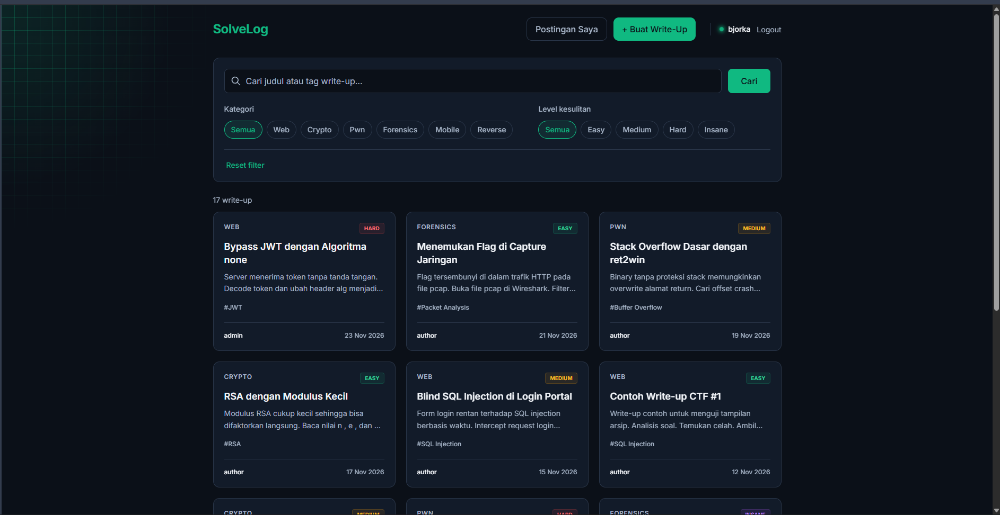
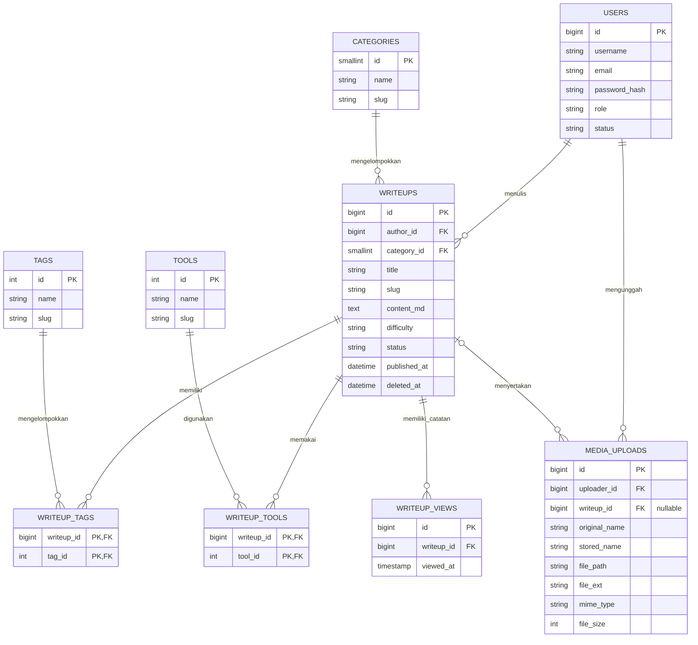

# SolveLog

Arsip terpusat untuk menyimpan, mengelompokkan, mencari, dan membaca write-up Capture The Flag (CTF) serta bug bounty di Lembaga Edukasi GideonHeker.
**Demo:** https://solvelog.gideon.my.id/ | **Laporan:** https://docs.google.com/document/d/1xIQkVWRl9uU-JBi7cgRZlDlI2NL4uWwHRq6MtYjlwy8/edit?tab=t.0

## Tentang Proyek

Write-up CTF dan bug bounty di GideonHeker sebelumnya tersebar pada lima media: dokumen, catatan pribadi, grup percakapan, penyimpanan awan, dan repositori kode. Informasi tersebut belum memiliki klasifikasi dan belum dikelola melalui sistem terkomputerisasi. SolveLog menyediakan arsip web terpusat agar write-up dapat disimpan, diklasifikasikan, dicari, dan dibaca melalui satu aplikasi. Sistem ini dikembangkan untuk Lembaga Edukasi GideonHeker di Kubu Raya, Kalimantan Barat.

## Fitur

| Fitur                                                | Pembaca (tamu)  | Penulis (login) |
| ---------------------------------------------------- | --------------- | --------------- |
| Melihat daftar write-up yang telah terbit            | Ya              | Ya              |
| Membaca write-up terbit                              | Ya              | Ya              |
| Mencari berdasarkan judul atau nama tag              | Ya              | Ya              |
| Filter kategori dan tingkat kesulitan                | Ya              | Ya              |
| Membaca draft milik sendiri                          | Tidak           | Ya              |
| Registrasi dan autentikasi                           | Dapat mendaftar | Ya              |
| Mengelola profil                                     | Tidak           | Ya              |
| Membuat dan mengubah write-up                        | Tidak           | Ya              |
| Menyimpan write-up sebagai draft atau menerbitkannya | Tidak           | Ya              |
| Menghapus write-up dengan konfirmasi password        | Tidak           | Ya              |
| Mengunggah gambar untuk isi write-up                 | Tidak           | Ya              |
| Melihat halaman "Postingan Saya"                     | Tidak           | Ya              |

Write-up memiliki tingkat kesulitan `easy`, `medium`, `hard`, dan `insane`. Daftar publik hanya menampilkan write-up berstatus `published` yang sudah mencapai waktu publikasi. Daftar menggunakan pagination sebanyak 12 data per halaman.

## Tampilan

Ganti placeholder berikut dengan tangkapan layar aktual aplikasi.

- Dashboard: 
- Halaman baca write-up: 
- Editor write-up: 

## Teknologi

| Komponen       | Versi                                                                          | Fungsi                                                  |
| -------------- | ------------------------------------------------------------------------------ | ------------------------------------------------------- |
| PHP            | `^8.3` (composer); image development `php:8.3-apache`                          | Runtime aplikasi Laravel                                |
| Laravel        | `^13.17` (terkunci `13.40.0`)                                                  | Framework backend dan MVC                               |
| Laravel Breeze | `^2.4` (terkunci `2.4.2`)                                                      | Dasar fitur autentikasi                                 |
| PHPUnit        | `^12.5.12` (terkunci `12.5.43`)                                                | Pengujian otomatis                                      |
| Vite           | `^8.0.0` (terkunci `8.3.6`)                                                    | Build aset front-end                                    |
| Tailwind CSS   | `^3.1.0` (terkunci `3.4.19`)                                                   | Styling antarmuka                                       |
| Alpine.js      | `^3.4.2` (terkunci `3.17.5`)                                                   | Interaksi antarmuka ringan                              |
| Node.js        | `20`                                                                           | Instalasi dependensi dan build aset                     |
| MySQL          | `8.0`                                                                          | Basis data relasional                                   |
| Nginx          | `nginx:alpine` pada development; host Nginx pada produksi                      | Web server dan reverse proxy sesuai lingkungan          |
| Apache         | `php:8.3-apache` pada Dockerfile di ZIP; produksi menggunakan `php:8.4-apache` | Menjalankan PHP melalui `mod_php` pada container Apache |
| Docker Compose | Compose file `compose.dev.yaml`                                                | Menjalankan layanan development                         |

Versi terkunci yang ditampilkan dalam tanda kurung berasal dari `composer.lock` dan `package-lock.json`. `@tailwindcss/vite` tercantum sebagai dependency, tetapi tidak dipasang sebagai plugin pada `vite.config.js`; konfigurasi Vite saat ini menggunakan Laravel Vite Plugin dan PostCSS dengan Tailwind CSS 3.

## Arsitektur dan Struktur Direktori

SolveLog menggunakan pola Model-View-Controller (MVC) Laravel. Controller menangani request dan alur aplikasi, Model mengelola data serta relasi Eloquent, sedangkan View Blade menyajikan halaman.

```text
.
├── app/{Enums,Http,Models,Policies,View/Components}/ # Logika aplikasi, request, model, dan policy
├── bootstrap/                                        # Bootstrap Laravel
├── config/                                           # Konfigurasi aplikasi
├── database/{factories,migrations,seeders}/           # Skema dan data basis data
├── docker/{common/php-fpm,nginx}/                     # Dockerfile dan Nginx development
├── public/                                            # Entry point dan aset publik
├── resources/{css,js,views}/                          # Aset dan template Blade
├── routes/                                            # Rute web, auth, dan console
├── storage/                                           # Log, cache, session, dan file aplikasi
├── tests/Feature/                                     # Pengujian fungsional
├── compose.dev.yaml                                   # Definisi layanan development
├── composer.json / package.json                       # Dependensi PHP dan Node.js
├── phpunit.xml                                        # Konfigurasi PHPUnit
└── vite.config.js                                     # Konfigurasi Vite
```

Alur MVC: `GET /` → `WriteupController@index` → Model `Writeup` beserta relasinya → `resources/views/writeups/index.blade.php` → respons HTML ke browser.
Controller utama: `WriteupController`, `MediaUploadController`, `ProfileController`, dan controller Auth. Validasi dipisahkan ke Form Request (`StoreWriteupRequest`, `UpdateWriteupRequest`, `StoreMediaUploadRequest`, `ProfileUpdateRequest`, `LoginRequest`); otorisasi write-up menggunakan `WriteupPolicy`.

## Basis Data

Entitas utama aplikasi terdiri atas sembilan tabel berikut. Migration Laravel juga membuat tabel pendukung framework, seperti `sessions` dan `password_reset_tokens`.



- `users` menyimpan identitas, password hash, role, dan status; `categories`, `tags`, serta `tools` menyimpan taxonomy.
- `writeups` menyimpan konten Markdown, penulis, kategori, kesulitan, status, dan waktu publikasi.
- `writeup_tags` dan `writeup_tools` adalah tabel penghubung many-to-many dengan composite primary key dari dua foreign key.
- `media_uploads` mencatat gambar; `writeup_id` boleh `NULL` sebelum gambar dihubungkan ke write-up.
- `writeup_views` disiapkan untuk catatan kunjungan, tetapi belum mencatat kunjungan aktual. Tabel `writeups` memakai soft delete melalui `deleted_at`.

Delapan migration khusus aplikasi menggunakan penamaan `2026_11_07_100001` sampai `2026_11_07_100008`. Migration pengguna merupakan migration bawaan Laravel yang juga membentuk tabel pendukung autentikasi dan session.

## Memulai

### Prasyarat

- Git untuk mengambil source code.
- Docker Engine atau Docker Desktop.
- Docker Compose v2 (`docker compose`).
- Koneksi internet saat image dan dependency diunduh.

PHP, MySQL, dan Node.js dijalankan melalui container pada alur development yang disediakan; tidak harus dipasang langsung di host. `compose.dev.yaml` mendefinisikan empat layanan: `app`, `webserver`, `db`, dan `node`. Nginx memetakan port host 8000 ke port container 80; layanan Node memakai port 5173.

### Instalasi Development

Clone repositori ke komputer, masuk ke direktori proyek, lalu ikuti langkah berikut.

1. Salin konfigurasi environment.
    ```bash
    cp .env.example .env
    ```
2. Ubah konfigurasi database di `.env` agar menggunakan MySQL pada jaringan Compose. Nilai password berikut hanya untuk development lokal; ganti dan kelola dengan mekanisme secret yang sesuai di produksi.
    ```env
    APP_NAME=SolveLog
    APP_ENV=local
    APP_DEBUG=true
    APP_URL=http://localhost:8000
    DB_CONNECTION=mysql
    DB_HOST=db
    DB_PORT=3306
    DB_DATABASE=laravel
    DB_USERNAME=laravel
    DB_PASSWORD=secret
    ```
3. Bangun image dan jalankan layanan development.
    ```bash
    docker compose -f compose.dev.yaml up -d --build
    ```
4. Pasang dependency PHP.
    ```bash
    docker compose -f compose.dev.yaml exec app composer install
    ```
5. Buat application key.
    ```bash
    docker compose -f compose.dev.yaml exec app php artisan key:generate
    ```
6. Jalankan migration.
    ```bash
    docker compose -f compose.dev.yaml exec app php artisan migrate
    ```
7. Isi data contoh untuk development.
    ```bash
    docker compose -f compose.dev.yaml exec app php artisan db:seed
    ```
    Seeder mengisi taxonomy, akun contoh, dan 18 write-up contoh (17 published dan 1 draft). Jangan gunakan data contoh sebagai data produksi. `DatabaseSeeder` menghentikan proses seeding ketika `APP_ENV` adalah `production`.
8. Buat symbolic link untuk storage publik.
    ```bash
    docker compose -f compose.dev.yaml exec app php artisan storage:link
    ```
9. Hapus penanda Vite development sebelum menggunakan aset hasil build.
    ```bash
    docker compose -f compose.dev.yaml exec app rm -f public/hot
    ```
10. Build aset front-end.
    ```bash
    docker compose -f compose.dev.yaml exec node npm run build
    ```

### Mengakses dan Menghentikan Aplikasi

Alamat development yang dikonfigurasi adalah `http://localhost:8000`. Namun, konfigurasi pada ZIP perlu diselaraskan terlebih dahulu: container `app` dibangun dari `php:8.3-apache`, sedangkan `docker/nginx/default.conf` meneruskan file PHP ke `app:9000` menggunakan FastCGI. Apache menerima HTTP pada port 80 dan bukan layanan PHP-FPM pada port 9000. Selain itu, Dockerfile menetapkan `WORKDIR /var/www/html`, sedangkan Compose me-mount source ke `/var/www`; Nginx membaca source dari `/var/www`. Karena itu, akses browser dan tautan storage belum dapat dianggap berfungsi tanpa penyelarasan konfigurasi.
Untuk menghentikan container tanpa menghapus named volume database:

```bash
docker compose -f compose.dev.yaml down
```

## Konfigurasi Environment

Variabel berikut tersedia pada `.env.example`. Sejumlah variabel koneksi MySQL ditulis sebagai komentar pada file contoh dan perlu diaktifkan saat memakai konfigurasi Compose.

| Variabel          | Nilai pada `.env.example`     | Keterangan                                                                                      |
| ----------------- | ----------------------------- | ----------------------------------------------------------------------------------------------- |
| `APP_NAME`        | `Laravel`                     | Nama aplikasi; dapat diubah menjadi `SolveLog`.                                                 |
| `APP_ENV`         | `local`                       | Lingkungan development.                                                                         |
| `APP_DEBUG`       | `true`                        | Aktif untuk development; nonaktifkan di produksi.                                               |
| `APP_URL`         | `http://localhost:8000`       | URL dasar aplikasi.                                                                             |
| `DB_CONNECTION`   | `sqlite`                      | Driver bawaan contoh; ubah menjadi `mysql` untuk Compose.                                       |
| `DB_HOST`         | `127.0.0.1` (contoh komentar) | Host database; gunakan `db` dalam jaringan Compose.                                             |
| `DB_PORT`         | `3306` (contoh komentar)      | Port MySQL.                                                                                     |
| `DB_DATABASE`     | `laravel` (contoh komentar)   | Nama database development.                                                                      |
| `DB_USERNAME`     | `root` (contoh komentar)      | User database pada contoh; sesuaikan dengan Compose.                                            |
| `DB_PASSWORD`     | kosong (contoh komentar)      | Password database; `secret` hanya digunakan untuk development lokal sesuai konfigurasi Compose. |
| `SESSION_DRIVER`  | `database`                    | Menyimpan session pada database.                                                                |
| `FILESYSTEM_DISK` | `local`                       | Disk default Laravel; controller unggah gambar secara eksplisit menggunakan disk `public`.      |

## Menjalankan Pengujian

Jalankan seluruh pengujian melalui container aplikasi:

```bash
docker compose -f compose.dev.yaml exec app php artisan test
```

`phpunit.xml` mengatur `DB_CONNECTION=sqlite` dan `DB_DATABASE=:memory:`. Dengan demikian, pengujian menggunakan database SQLite sementara dan tidak memakai database MySQL development.
Hasil terakhir yang dicatat dalam laporan adalah **146 test lulus dengan 849 assertion**. Angka tersebut merupakan hasil pengujian yang dilaporkan, bukan hasil eksekusi ulang pada sesi dokumentasi ini.

| Berkas pengujian                            | Cakupan utama                                                                                    |
| ------------------------------------------- | ------------------------------------------------------------------------------------------------ |
| `tests/Feature/Auth/AuthenticationTest.php` | Tampilan login, login berhasil/gagal, dan logout.                                                |
| `tests/Feature/Auth/RegistrationTest.php`   | Registrasi, username duplikat, dan batas panjang username.                                       |
| `tests/Feature/Auth/PasswordUpdateTest.php` | Perubahan password dan validasi password saat ini.                                               |
| `tests/Feature/MediaUploadTest.php`         | Format dan isi gambar, ukuran maksimal 2 MB, otorisasi, dan throttle unggah.                     |
| `tests/Feature/ProfileTest.php`             | Ringkasan profil, perubahan data, email, password, penghapusan akun, dan query halaman profil.   |
| `tests/Feature/WriteupCreateTest.php`       | Form, validasi, pembuatan draft/published, tag, tools, slug, dan pengaitan media.                |
| `tests/Feature/WriteupIndexTest.php`        | Daftar publik, pencarian judul/tag, filter, pagination, dan halaman milik penulis.               |
| `tests/Feature/WriteupManageTest.php`       | Otorisasi pemilik, edit, perubahan status, konfirmasi password, soft delete, dan throttle hapus. |
| `tests/Feature/WriteupShowTest.php`         | Hak akses halaman baca, draft, penyaringan Markdown, galeri, tag, dan tools.                     |

## Rute Utama

| Metode   | URL                        | Akses               | Deskripsi                                                                              |
| -------- | -------------------------- | ------------------- | -------------------------------------------------------------------------------------- |
| `GET`    | `/`                        | Publik              | Daftar write-up published, pencarian, filter, dan pagination. Nama route: `dashboard`. |
| `GET`    | `/writeups/{writeup}`      | Publik terbatas     | Membaca write-up published; draft hanya dapat dibaca pemiliknya.                       |
| `GET`    | `/register`                | Tamu                | Form registrasi penulis.                                                               |
| `POST`   | `/register`                | Tamu                | Memproses registrasi.                                                                  |
| `GET`    | `/login`                   | Tamu                | Form login.                                                                            |
| `POST`   | `/login`                   | Tamu                | Memproses login; maksimal lima percobaan gagal per kombinasi email dan IP.             |
| `POST`   | `/logout`                  | Login               | Mengakhiri sesi pengguna.                                                              |
| `GET`    | `/postingan-saya`          | Login               | Daftar write-up milik pengguna, termasuk draft.                                        |
| `GET`    | `/writeups/create`         | Login, akun aktif   | Form membuat write-up.                                                                 |
| `POST`   | `/writeups`                | Login, akun aktif   | Menyimpan write-up sebagai draft atau published.                                       |
| `GET`    | `/writeups/{writeup}/edit` | Pemilik, akun aktif | Form mengubah write-up; diperiksa oleh Policy.                                         |
| `PUT`    | `/writeups/{writeup}`      | Pemilik, akun aktif | Memperbarui write-up.                                                                  |
| `DELETE` | `/writeups/{writeup}`      | Pemilik, akun aktif | Menghapus write-up setelah konfirmasi password; soft delete.                           |
| `POST`   | `/writeups/media`          | Login, akun aktif   | Mengunggah gambar untuk write-up.                                                      |
| `GET`    | `/profile`                 | Login               | Menampilkan profil dan ringkasan write-up sendiri.                                     |
| `PATCH`  | `/profile`                 | Login               | Memperbarui informasi profil.                                                          |
| `DELETE` | `/profile`                 | Login               | Menghapus akun setelah konfirmasi password dan pemeriksaan kepemilikan konten.         |
| `GET`    | `/test`                    | Publik              | Rute sementara yang menampilkan view dashboard; sebaiknya dihapus.                     |

Rute password reset dan verifikasi email juga tersedia melalui `routes/auth.php`. Parameter pencarian adalah `q`, filter kategori adalah `kategori`, dan filter tingkat kesulitan adalah `level`.

## Keamanan

- `WriteupPolicy` mengatur hak akses: write-up published dapat dibaca publik, sedangkan draft hanya dapat dibaca pemiliknya.
- Akun aktif diperlukan untuk mengelola write-up dan mengunggah gambar. Akun banned tetap dapat login, tetapi tidak dapat membuat, mengubah, menghapus write-up, atau mengunggah gambar.
- Form Request memvalidasi request di server. `author_id`, `slug`, dan `published_at` ditentukan oleh server.
- Password di-hash pada kolom `password_hash`; Laravel CSRF protection melindungi request yang mengubah data dan session diperbarui saat login.
- Eloquent memakai parameter binding. Markdown membuang HTML mentah dan menolak unsafe link.
- Gambar JPG, JPEG, PNG, GIF, dan WebP divalidasi berdasarkan isi/tipe file, dibatasi 2 MB, dan diberi nama UUID.
- Throttle: `profile.update` 10/menit, `profile.destroy` 5/menit, `writeups.destroy` 5/menit, unggah media 20/menit, serta login lima kegagalan per kombinasi email dan IP.

## Deployment Produksi

Deployment yang dijelaskan untuk server produksi menggunakan AWS EC2 dengan Ubuntu, container Docker berbasis Apache + PHP 8.4 (`mod_php`), MySQL terkelola, serta Nginx dan Certbot pada host. Arsitekturnya adalah **Nginx reverse proxy di host Ubuntu → Apache pada container Docker**.

1. Siapkan instance AWS EC2 berbasis Ubuntu dan atur akses jaringan untuk HTTP (80) serta HTTPS (443).
2. Siapkan image/container aplikasi berbasis Apache. Container `web-wu` menggunakan image `php:8.4-apache` dan menjalankan Laravel melalui `mod_php`; Dockerfile produksi berbasis Apache, bukan PHP-FPM.
3. Petakan port HTTP container ke `127.0.0.1:8080:80` pada host. Apache melayani request Laravel dan aturan `public/.htaccess`.
4. Build aset front-end menggunakan Node.js 20. Atur kepemilikan `storage` dan `bootstrap/cache` agar dapat ditulis oleh `www-data`.
5. Konfigurasikan koneksi ke layanan MySQL terkelola Aiven dengan SSL. Simpan seluruh kredensial dan sertifikat pada konfigurasi rahasia server; jangan masukkan ke repositori atau README.
6. Jalankan migration produksi menggunakan `php artisan migrate --force`. Seeder bawaan proyek memiliki pemeriksaan `APP_ENV=production` dan tidak menjalankan data contoh pada lingkungan produksi.
7. Arahkan DNS domain ke instance EC2, lalu konfigurasi Nginx host untuk meneruskan request ke `127.0.0.1:8080`.
8. Aktifkan HTTPS menggunakan Certbot dari Let's Encrypt, atur pengalihan HTTP ke HTTPS, dan sesuaikan `APP_URL` dengan URL HTTPS produksi.

URL produksi: https://solvelog.gideon.my.id/. Detail kredensial database, nama host layanan database, dan berkas sertifikat tidak dicantumkan.

## Keterbatasan dan Rencana Pengembangan

### Keterbatasan Saat Ini

- Fitur administrator belum diimplementasikan. Kolom `role` dan enum `UserRole` sudah tersedia, tetapi belum ada panel admin maupun pengelolaan pengguna dan taxonomy.
- Akun banned masih dapat login; pembatasan diterapkan pada pengelolaan write-up dan unggah gambar.
- Gambar yang sudah diunggah tetapi tidak pernah dihubungkan ke write-up belum dibersihkan secara otomatis.
- Tabel `writeup_views` belum digunakan untuk pencatatan kunjungan aktual. Seeder dapat mengisi data kunjungan contoh.
- Filter khusus tag dan tools belum tersedia. Pencarian berdasarkan judul dan nama tag sudah tersedia.
- Load testing dan penetration testing belum dilakukan.
- Aplikasi belum dievaluasi oleh pengguna dari Lembaga Edukasi GideonHeker.
- Write-up lama milik lembaga belum dimigrasikan; data contoh disediakan melalui seeder untuk development dan demonstrasi.

### Rencana Pengembangan

- Mengembangkan panel administrator, pengelolaan akun, moderasi konten, dan pengelolaan kategori, tag, serta tools.
- Menambahkan filter berdasarkan tag dan tools.
- Mengimplementasikan pencatatan kunjungan write-up secara aktual.
- Menambahkan mekanisme pembersihan gambar yang tidak terpakai.
- Memigrasikan arsip write-up lama setelah proses pemetaan dan validasi data.
- Melakukan load testing, penetration testing, dan evaluasi kegunaan bersama pengguna lembaga.

## Pemecahan Masalah

### Halaman `localhost:8000` tidak dapat memproses PHP

Periksa `docker/nginx/default.conf` dan Dockerfile yang dirujuk `compose.dev.yaml`. Konfigurasi Nginx saat ini memakai `fastcgi_pass app:9000`, tetapi container `app` dibangun dari image Apache yang melayani HTTP pada port 80. Samakan arsitektur kedua layanan: gunakan upstream HTTP ke Apache atau gunakan image PHP-FPM dengan konfigurasi FastCGI yang sesuai. Setelah mengubah konfigurasi, bangun ulang layanan.

### Koneksi database gagal

Pastikan `.env` menggunakan `DB_CONNECTION=mysql`, `DB_HOST=db`, `DB_PORT=3306`, `DB_DATABASE=laravel`, dan `DB_USERNAME=laravel`. Periksa status container database dan log layanan:

```bash
docker compose -f compose.dev.yaml ps
docker compose -f compose.dev.yaml logs db
```

### CSS atau JavaScript tidak termuat

Periksa apakah `public/hot` masih ada. Untuk menggunakan aset hasil build, hapus file tersebut lalu jalankan build front-end:

```bash
docker compose -f compose.dev.yaml exec app rm -f public/hot
docker compose -f compose.dev.yaml exec node npm run build
```

### Gambar tidak tampil setelah diunggah

Pastikan symbolic link storage sudah dibuat dan file tersimpan pada disk `public`:

```bash
docker compose -f compose.dev.yaml exec app php artisan storage:link
```

Pastikan direktori storage dapat ditulis oleh proses PHP di lingkungan yang digunakan.

## Kontribusi

Kontribusi dapat berupa laporan bug, usulan fitur, perbaikan dokumentasi, atau pull request. Sertakan ringkasan perubahan, alasan perubahan, langkah untuk menguji, dan hasil pengujian yang relevan. Untuk perubahan fitur, tambahkan atau sesuaikan Feature Test agar perilaku baru dapat diperiksa.

## Lisensi

## Pengembang

**Gideon Mangatas Chandra Panjaitan**
